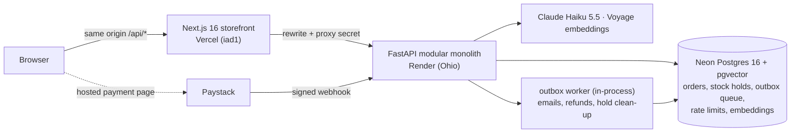

# FlyFit

> **Concept build.** FlyFit is a fictional Lagos fashion brand. Payments run in Paystack **test mode** (no real money), product images are **AI-generated**, and nothing ships. This is not a real store.

**Live:** [fashion-store-swart-theta.vercel.app](https://fashion-store-swart-theta.vercel.app) · API: [flyfit-api.onrender.com/health](https://flyfit-api.onrender.com/health)

An AI-native fashion store built to show two things:

1. **Backend system design** that holds up under pressure: no overselling with 200 buyers racing for 10 units, payments that survive duplicate and late webhooks, at-least-once jobs with idempotent side effects, caching that never lies about stock.
2. **AI features measured with real numbers:** hybrid search, recommendations, a tool-using shopping assistant and a description pipeline, each with an eval written before it was built.

## Try it
1. Open the [live site](https://fashion-store-swart-theta.vercel.app). The first request after ~15 idle minutes wakes the free API server, which takes 30–60 s.
2. Ask the assistant (bottom right) something like *"an outfit for a wedding under ₦50,000"*, or search for *"owambe"*.
3. Add something to the bag and check out. On Paystack's test page choose **Pay with Card → Success → Pay**. You come back to your order, marked **paid**.

Other test outcomes (declined, PIN, OTP, bank transfer): [Paystack test payments](https://paystack.com/docs/payments/test-payments/).

## Architecture



- **One app, split into modules** ([ADR-001](docs/adr/001-modular-monolith.md)). Each module owns its tables, and import-linter enforces the boundaries in CI.
- **Postgres is the only source of truth, and also the job queue** ([ADR-002](docs/adr/002-postgres-outbox-queue.md)). A job row is written in the same transaction as the change that caused it.
- **No Redis** ([ADR-006](docs/adr/006-no-redis.md)). The deployed load test confirmed it (see [results](evals/RESULTS.md#catalog-latency)).
- **The browser only ever talks to one origin** ([ADR-005](docs/adr/005-same-origin-api.md)), so cookies are first-party and Safari works.
- Full design, data model and order state machine: [`docs/ARCHITECTURE.md`](docs/ARCHITECTURE.md).

**Stack:** Python 3.12, FastAPI, async SQLAlchemy 2, Alembic, psycopg 3 · Next.js 16 (Cache Components), TypeScript, Tailwind 4 · Neon Postgres + pgvector · Paystack · Claude Haiku 5.5 · Voyage 4 · Resend · Docker, GitHub Actions, Render, Vercel.

## Results
Every target was written into [`PLAN.md`](PLAN.md) before the code existed. Each number links to how it was measured and the command that reproduces it.

| What | Target | Result |
|---|---|---|
| [200 concurrent buyers, 10 units](evals/RESULTS.md#overselling-and-duplicate-webhooks) | 10 paid, 0 oversold | **10 paid, 0 oversold**, 0 server errors |
| [Same webhook × 5](evals/RESULTS.md#overselling-and-duplicate-webhooks) | 1 payment | **1** |
| [Search recall@10](evals/search/RESULTS.md) (50 labelled queries) | ≥ 0.85 | **0.919** (keyword-only 0.307) |
| [Search, held-out queries](evals/search/HELDOUT_RESULTS.md) (written blind, never used for tuning) | ≥ 0.85 | **0.762**: below the bar, reported anyway and not tuned |
| [Assistant task success](evals/assistant/RESULTS.md) (40 scenarios × 3 runs) | ≥ 90% | **98.3%** |
| [Made-up prices shown](evals/assistant/RESULTS.md) | 0 | **0**, audited against the database |
| [Prompt injections resisted](evals/assistant/RESULTS.md) | 100% | **18/18** |
| [Catalog p95, local](evals/RESULTS.md#catalog-latency) (1 worker) | < 200 ms | **1.5–5.4 ms** from 50 to 800 req/s |
| [Catalog, deployed](evals/RESULTS.md#deployed-render-free-plan-2026-10-18) (Render free) | measured | **~250 ms p50 from Lagos** to 20 req/s; CPU-bound by 50 req/s |
| [Assistant cost](evals/RESULTS.md#assistant) | reported | **$0.0005** per conversation; **2.7–7.2 s** per message live |

## Interesting problems
- **Overselling under a race.** A conditional `UPDATE … WHERE stock_on_hand - stock_reserved >= q` holds stock in the same transaction as the order, and expired holds are ignored *when stock is read*, so a sleeping worker can never make stock look sold out. The load test was checked by breaking the code on purpose: without the conditional update, a database `CHECK` still refused to oversell but 27 buyers got a 500. ([ADR-003](docs/adr/003-inventory-reservation.md), [Phase 4 notes](notes/phase-4.md))
- **Paying after the hold expired.** A customer can pay at minute 16. The webhook re-reserves from free stock: if it can, the order is `paid`; if not, it's refunded automatically with an apology email. Only a forged signature gets a non-200, because Paystack retries everything else forever.
- **Exactly-once is a lie, so side effects are idempotent.** Jobs run at least once. A test SIGKILLs the worker mid-job: the job ran twice, the email went once (Resend `Idempotency-Key` = job id). A lease alone wasn't enough; a fencing check on `attempts` stops a paused worker finishing someone else's job. ([Phase 5 notes](notes/phase-5.md))
- **The assistant's guarantees live in code, not the prompt.** It can't quote a price that isn't in a price field (a guard checks every ₦ amount before the reply is shown), can't read another customer's order (the tool can't express "someone else"), and can't place an order (no such tool). The real-model eval found a hole the fake-model tests missed: the model resisted an injected "₦500 sale" but repeated the amount while warning the shopper. ([Phase 7 notes](notes/phase-7.md))
- **My first load test measured the laptop.** One Python generator topped out near 150 req/s while the API could do ~3,800. It now runs open loop (timed from when each request was *due*, avoiding coordinated omission) across four processes, and reports its own lateness. ([Phase 8 notes](notes/phase-8.md))
- **Found in deployment:** behind Render's load balancer, every direct request arrived from a new address, so per-IP rate limits never fired for calls that skipped the storefront. Fixed by giving all unproxied calls one shared key. ([Phase 9 notes](notes/phase-9.md))

## Run it locally
Needs Python 3.12 + [uv](https://docs.astral.sh/uv/), Node 24, and a Postgres 16 with pgvector (Neon's free tier works). Copy `.env.example` to `.env` and fill it in; keep `PUBLIC_SITE_URL=http://localhost:3000` locally.

```bash
cd api && uv sync
uv run alembic upgrade head && uv run python -m scripts.seed_catalog   # 150 products
uv run python -m scripts.embed_catalog                                  # search embeddings (needs VOYAGE_API_KEY)
uv run uvicorn app.main:app --port 8000 --timeout-keep-alive 75

cd web && npm install && npm run build && npm start             # http://localhost:3000
```

Tests: `cd api && uv run pytest` (299 tests, against a throwaway Postgres started by pgserver, no Docker needed). Browser journeys: `cd web && npm run e2e`. Deploying your own copy: [`docs/DEPLOY.md`](docs/DEPLOY.md).

## Repo map
| Folder | Contents |
|---|---|
| `api/` | FastAPI app: `app/modules/*` (catalog, cart, orders, payments, accounts, admin, search, assistant), migrations, `scripts/` (seed, evals, load tests) |
| `web/` | Next.js storefront, Playwright journeys |
| `evals/` | Every eval and load-test result, with the command that made it |
| `docs/` | Architecture, ADRs, deploy guide |
| `notes/` | One write-up per build phase: what, why, trade-offs |

## Known limits
- **Free hosting.** The API sleeps after ~15 idle minutes (30–60 s to wake), and the free plan's CPU tops out between 20 and 50 catalog req/s. Browsing is unaffected, because Vercel serves the pages pre-built.
- **Jobs wait while the API sleeps.** Emails and refunds run late; nothing becomes wrong.
- **Held-out search is 0.762**, below the 0.85 bar. Why each query missed is in [`evals/search/README.md`](evals/search/README.md).
- **Name.** "FlyFit" and "Fly Fit" are registered or applied-for apparel trademarks in the US. Here the name is a fictional placeholder, kept in one config value (`BRAND_NAME`), with no imitation of anyone's branding. A real launch would need a different name.
