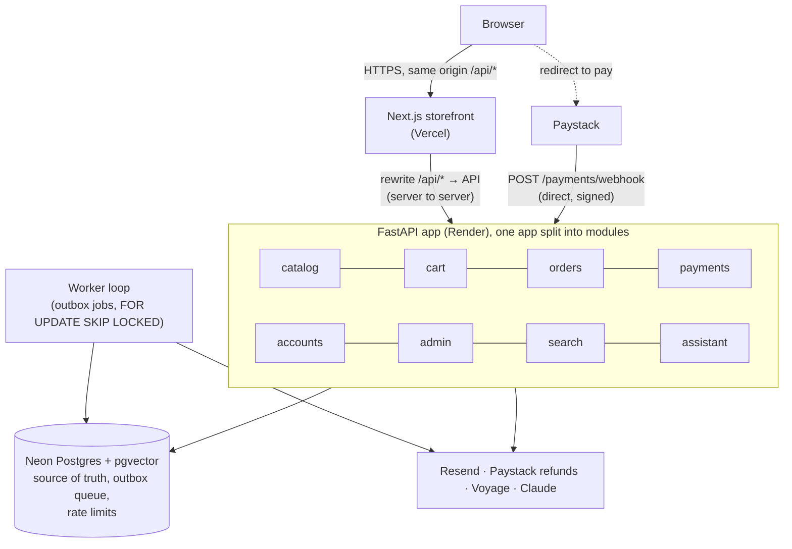
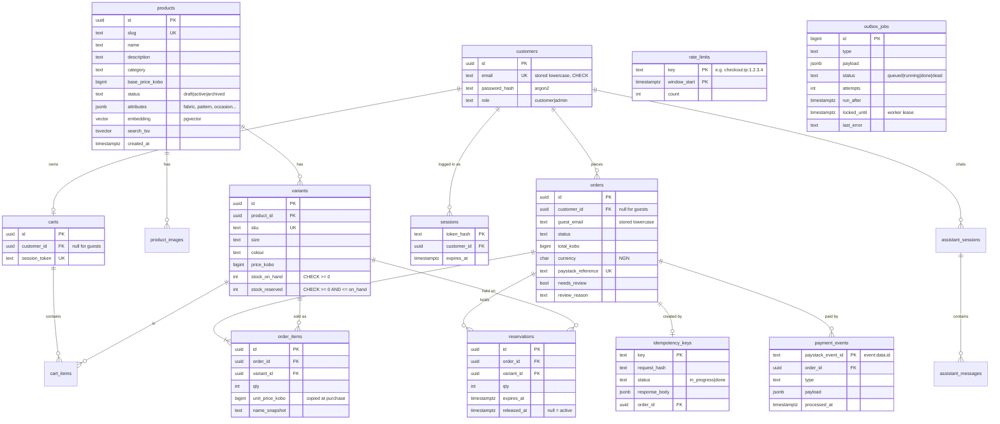
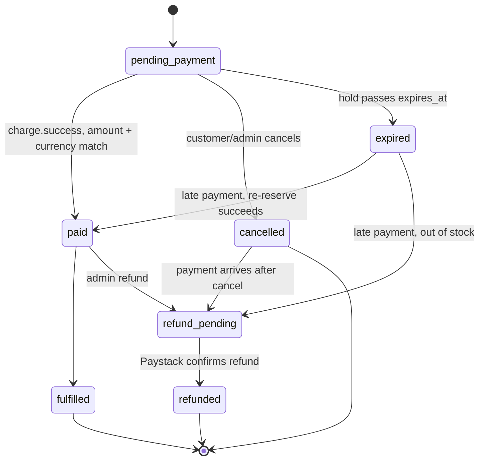
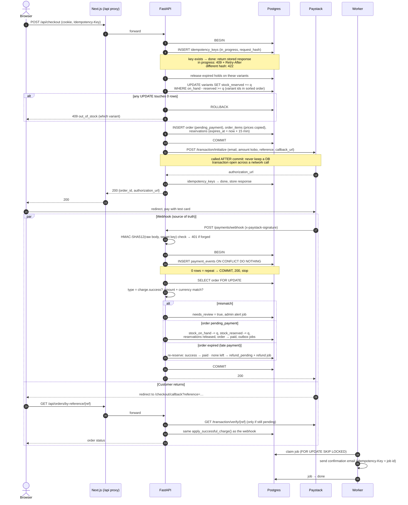

# FlyFit architecture

FlyFit is a concept build: a fictional brand, Paystack in test mode, AI-generated images. This document covers how the system is put together. The reasons behind each choice are in [`adr/`](adr/).

## 1. Components

| Piece | Job | Rule |
|---|---|---|
| Next.js | Pages, and the proxy for every browser API call | The browser never calls the API domain directly ([ADR-005](adr/005-same-origin-api.md)) |
| FastAPI | All business logic | Each module owns its tables and is used by other modules only through its service interface ([ADR-001](adr/001-modular-monolith.md)) |
| Postgres | Every durable fact, plus the job queue | A job is written in the same transaction as the change that caused it ([ADR-002](adr/002-postgres-outbox-queue.md)) |
| Caches | Next.js ISR for pages; in-process TTL cache for catalog API responses | Safe to lose at any time; never the only copy. No Redis ([ADR-006](adr/006-no-redis.md)) |
| Worker | Emails, refunds, hold clean-up, embeddings, alerts | At least once, so every side effect is idempotent. Runs inside the API process on the free tier |

### Module → table ownership

| Module | Owns |
|---|---|
| catalog | `products`, `variants`, `product_images` |
| cart | `carts`, `cart_items` |
| orders | `orders`, `order_items`, `reservations`, `idempotency_keys` |
| payments | `payment_events` |
| accounts | `customers`, `sessions` |
| assistant | `assistant_sessions`, `assistant_messages` |
| (shared infra) | `outbox_jobs`, `rate_limits` (UNLOGGED) |

`admin` and `search` own no tables. They call the other modules' services. One exception is allowed and written down: stock changes (`variants.stock_*`) happen only inside `orders.inventory`, never in `catalog`, so that all the concurrency rules live in one file.

## 2. Data model (ERD)

This is the first draft. Phase 1 turns it into Alembic migrations. All money is `BIGINT` kobo ([ADR-004](adr/004-money-in-kobo.md)).

**Invariants that tests check:**
- `0 <= stock_reserved <= stock_on_hand` for every variant (enforced by `CHECK` constraints, so a bug fails loudly instead of overselling).
- `stock_reserved` = the sum of `qty` over that variant's reservations where `released_at IS NULL`.
- `order_items.unit_price_kobo` is never read from `products` after the order is created.

## 3. Order state machine

All moves go through `orders.state.transition(order, to_state)` on an order locked with `lock_order()` (`SELECT ... FOR UPDATE`); any move not shown here raises `InvalidTransition`. The webhook, the callback check and the expiry job all use it, so they can never race each other into an invalid state.

## 4. Checkout sequence: checkout → Paystack → webhook → paid

**Key points:**
1. **Steps 3–12 are one transaction.** Either the stock is held *and* the order exists, or neither happens.
2. **The conditional `UPDATE` does all the concurrency work.** Postgres takes a row lock, so 200 buyers racing for 10 units queue up on that row and only 10 `UPDATE`s match. Variants are updated in sorted id order so that two multi-item carts can't deadlock.
3. **The redirect is never trusted.** The callback page either reads state the webhook already wrote, or calls Paystack's verify API itself. Both paths call the same idempotent `apply_successful_charge()`, so it doesn't matter which one arrives first.
4. **Only a forged signature gets a non-200.** Paystack retries anything else, so an unexpected event is recorded and flagged instead of rejected.
5. **Late payments are handled.** An expired hold no longer counts as reserved stock, so the webhook re-reserves the stock, or refunds if it's gone ([ADR-003](adr/003-inventory-reservation.md)).

## 5. Cross-cutting

- **Request IDs:** Next.js sets `X-Request-ID` if it is missing. The API logs it on every line and copies it into each outbox job's payload, so one checkout can be traced from browser to email.
- **Logs:** JSON lines (`ts, level, request_id, module, event, ...`). No card data ever reaches us (Paystack hosts the payment page), and emails are masked in logs.
- **Rate limits (Postgres, ADR-006):** checkout and assistant, per IP and per customer, as fixed-window counters in an `UNLOGGED` table (one upsert per request). The assistant's daily spend cap is a normal (logged) row, because it is money.
- **Caching:** product pages use Next.js ISR, revalidated when a product changes. Catalog API responses use an in-process TTL cache (60 s), cleared in the same process when admin edits a product. This is correct while there is one API instance; ADR-006 says what changes at two.
- **Config:** everything comes from environment variables (see [`.env.example`](../.env.example)). The brand name is one variable.
