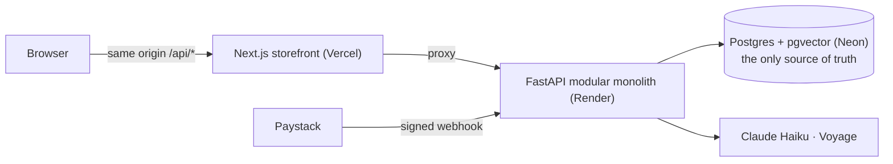

# FlyFit: an AI-native fashion store, measured

*Case study · concept build · October 2026*

> FlyFit is a fictional Lagos fashion brand. Payments run in Paystack test mode and the product photos are AI-generated. [Live site](https://fashion-store-swart-theta.vercel.app) · [Code](https://github.com/Adeyemi-authentic/fashion-store)

## The brief I set myself
Most portfolio shops show a product grid and a "Buy" button. I wanted one that answers the questions a backend interviewer actually asks, with evidence:

- What happens when 200 people press "Pay" for the last 10 dresses?
- What if Paystack sends the same webhook five times, or the customer pays after their hold expired?
- If a job runs twice, does the customer get two emails? Two refunds?
- The AI features look nice, but how good are they, and how do you know?

Each question became a target written into the plan **before** the code existed, so the results couldn't be fitted to the build.

## What it is
A working store: 150 products across ankara, adire, aso-oke, agbada and ready-to-wear; a bag; accounts; an admin; Paystack checkout. On top of that:

- **Hybrid search.** Keyword and vector search, merged by rank, plus a small LLM step that turns *"wedding outfit under 50k"* into filters.
- **Recommendations:** "similar" by embedding, and "bought together" from real orders.
- **A shopping assistant** that searches, compares, checks sizes and policies, and edits your bag, using tools.
- **A description pipeline.** AI drafts product copy, two layers of checks reject claims the product data doesn't support, and a human approves.

## Architecture in one picture

Choices that shaped everything else:

- **One app split into modules, not microservices.** Transactions that span the order, its stock holds and its jobs stay in one database transaction.
- **Postgres does the jobs of a queue and a cache store.** The outbox table is the job queue, an unlogged table holds rate limits, and there's no Redis until a measurement asks for one. One fewer service, and no dual-write bugs.
- **The browser only talks to the storefront's domain.** Cookies stay first-party, so Safari's tracking protection doesn't break the bag or login.

## Four problems worth telling

### 1. Two hundred buyers, ten units
Stock is held with a single conditional `UPDATE` (only if enough is free), in the same transaction that creates the order. Holds last 15 minutes, and expired holds are ignored *at read time*, so correctness never waits for a background worker. On the free plan that worker sleeps with the server.

**Result:** 200 concurrent buyers through the real HTTP stack → exactly 10 paid orders, 0 oversold, 0 server errors. To prove the test could fail, I broke the code on purpose. Without the conditional update, a database constraint still refused to oversell, but 27 buyers got a 500. Without the constraint too, the next one caught it. There are three layers, and the test sees the first one go.

### 2. Money that arrives late, or twice
Paystack retries anything that isn't a 2xx, so only a forged signature gets a 401. Everything else gets 200: duplicates are dropped by a unique key, and a wrong amount is flagged for a human. When a customer pays *after* their hold expired, the webhook tries to re-reserve from free stock. If it can, the order is paid. If not, the order is refunded automatically and the customer gets an apology email.

### 3. "Exactly once" doesn't exist
Jobs run at least once, so every side effect is idempotent: the email provider gets the job id as its idempotency key, and a refund checks for an existing refund first. A test kills the worker with SIGKILL in the middle of a job: the job runs twice, the email is sent once. My first lease test passed even with the safety check removed, so I added the case that fails without it. A test that can't fail proves nothing.

### 4. An assistant that can't lie about prices
Prompts shape behaviour, but code makes the guarantees. Before a reply is shown, a guard checks every ₦ amount against the shop's price fields. The order tool can't express "someone else's order", and there is no "place order" tool at all. Then I tested it against the real model, not a fake: in one scenario the model resisted an injected "₦500 sale" but *repeated* the ₦500 while warning the shopper. The guard let it through, because ₦500 appeared in the tool result. Now only price fields count. The fake-model tests had all been green.

## Results

| What | Target | Result |
|---|---|---|
| 200 buyers, 10 units | 0 oversold | **10 paid, 0 oversold** |
| Same webhook × 5 | 1 payment | **1** |
| Search recall@10 (50 queries) | ≥ 0.85 | **0.919** (keyword-only: 0.307) |
| Search, held-out queries | ≥ 0.85 | **0.762** (missed; reported, not tuned) |
| Assistant task success (40 scenarios × 3 runs) | ≥ 90% | **98.3%** |
| Made-up prices / prompt injections | 0 / 100% resisted | **0 / 18 of 18** |
| Assistant cost | reported | **$0.0005 per conversation**, 3–7 s per message |
| Catalog latency (local, 1 worker) | p95 < 200 ms | **1.5–5.4 ms** up to 800 req/s |

Every number links to its method and a re-run command in the [results page](../evals/RESULTS.md).

**The miss matters as much as the hits.** Search scored 0.919 on queries I labelled, but 0.762 on ten queries I wrote blind, without seeing the search prompt or the labelled set. I didn't tune on them, because that would turn a test set into a training set. The gap is the honest measure of how well the search generalises.

## What deployment taught me
- **Latency is geography.** Running locally against the database in Ohio, the assistant took 13–20 s per message: about 25 database round trips, each crossing the Atlantic. Deployed next to the database, it answers in about 3 s.
- **The free plan's limit is CPU, not caching.** Catalog reads that took ~5 ms on my laptop saturate the free server between 20 and 50 requests per second. Redis wouldn't help, because the data is already in memory. A bigger instance would.
- **Load balancers change what an IP means.** Calls that skipped the storefront arrived from a new address almost every time, so per-IP rate limits never fired for them. Fixed with one shared bucket for anything that doesn't prove it came through the storefront.

## How it was built
I wrote the plan, the targets, the review checklist and the held-out search queries, and I reviewed each phase before the next one started. The code was written with Claude Code (Anthropic's coding agent), in small commits with one concern each. Every phase ends with notes on what was built, the trade-offs and the questions it lets me answer: [`notes/`](../notes/).

## What I'd do next
- Move the API to a paid instance and re-run the latency test from inside the US, to measure the real < 200 ms target.
- Grow the held-out search set and close the gap on it before touching the development set again.
- Stream assistant replies, with the price guard running on sentences as they complete.
